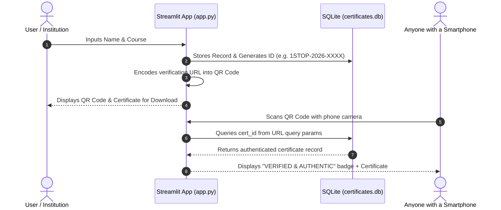

# 🎓 1stop Certificate Verification & QR Code Traceback System

A modern, full-stack **Streamlit** web application for generating tamper-evident certificates with scannable QR codes that trace back directly to the verification portal.

Styled after the **1stop / One Stop Tech** certificate verification interface (`onestoptech.org/verify`).

---

## 🌟 Key Features

1. **Certificate & QR Code Generation**:
   - Input **Student Name**, **Course Name**, Email, Issue Date, Grade/Distinction, and Issuing Authority.
   - Automatically assigns a unique certificate verification ID (e.g. `1STOP-2026-XXXX`).
   - Automatically renders a high-resolution, landscape certificate (`1600 x 1130 px`) with official borders, signatures, authenticity seal, and the verification QR code stamped on it.
   - Generates high-contrast QR code encoding the direct traceback verification URL.

2. **QR Code Traceback & Verification**:
   - When any person scans the QR code using their smartphone camera or a QR scanner app, it immediately opens the website:
     ```
     http://<IP_OR_DOMAIN>:8501/?cert_id=1STOP-2026-XXXX
     ```
   - The web app reads the `cert_id` query parameter automatically and displays:
     - 🟢 **OFFICIALLY VERIFIED & AUTHENTIC** verification banner
     - Student Name & Course Title
     - Certificate Verification ID
     - Issue Date, Grade, and Issuing Authority
     - Live Certificate Preview with 1-click download (PNG)
     - Standalone high-res QR Code download

3. **Manual Verification Search (Matching Reference Screenshot)**:
   - Enter Certificate ID or student Email address in the verification card.
   - Instant search against the persistent SQLite registry (`certificates.db`).

4. **Multi-Device & Mobile Scanning Support**:
   - Automatically detects your local network IP (e.g. `http://10.90.7.32:8501`).
   - QR codes can be generated using your Local IP so smartphones connected to the same Wi-Fi/LAN can scan and verify immediately.
   - Supports Localhost mode (for local browser testing) and custom public URLs (ngrok / deployed domains).

5. **Certificate Registry**:
   - Browse all issued certificates, view details, re-download certificates, and re-download QR codes at any time.

---

## 📁 Directory Structure

```text
A:\TEMP APP\
├── app.py                     # Main Streamlit web application
├── certificate_generator.py   # Certificate rendering, QR code engine & SQLite DB
├── certificates.db            # Persistent SQLite database of issued certificates
├── requirements.txt           # Python dependencies (streamlit, qrcode, pillow)
├── run_app.bat                # 1-Click launcher for Windows
└── README.md                  # Complete documentation and user guide
```

---

## 🚀 How to Run the App

### Option A: One-Click Launch (Recommended for Windows)
Simply double-click the **`run_app.bat`** file located in `A:\TEMP APP\`.

### Option B: From Command Prompt or PowerShell
```powershell
cd "A:\TEMP APP"
python -m streamlit run app.py --server.port 8501 --server.address 0.0.0.0
```

Once started, open your web browser at:
- **Local machine:** [http://localhost:8501](http://localhost:8501)
- **From mobile phone on same Wi-Fi:** `http://<YOUR_LOCAL_IP>:8501` (displayed in the sidebar)

---

## 📲 How the QR Code Traceback Works



---

## 🛠️ Technology Stack
- **Frontend / Framework:** Streamlit (Python)
- **Certificate & Graphic Rendering:** Pillow (PIL) with high-res typography and vectors
- **QR Code Generation:** `qrcode[pil]` with high error correction (Level H)
- **Database:** SQLite (`certificates.db`)
